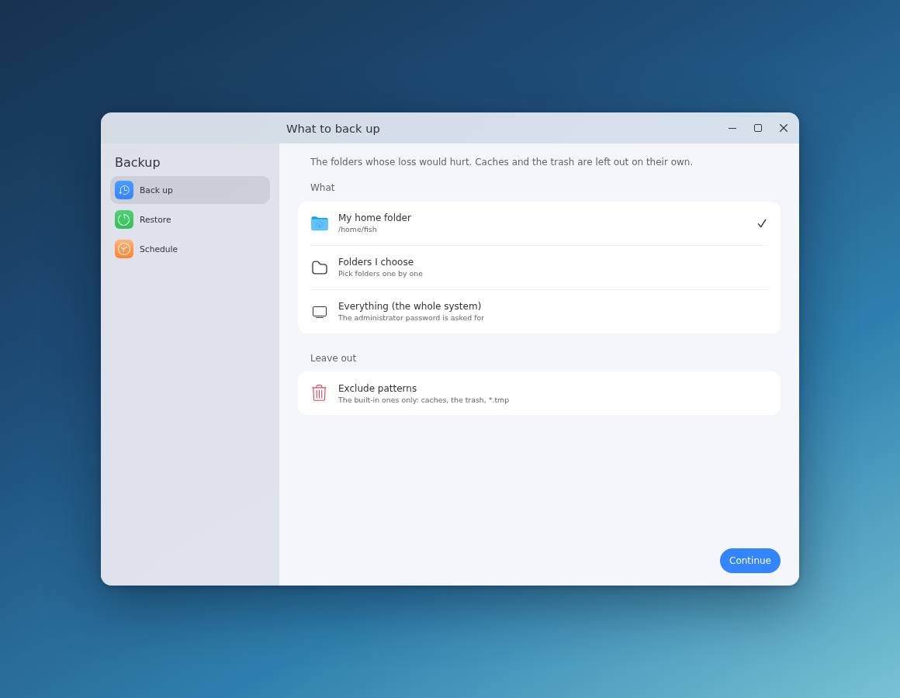
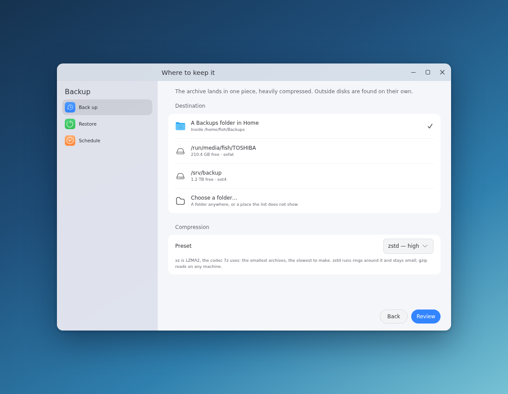
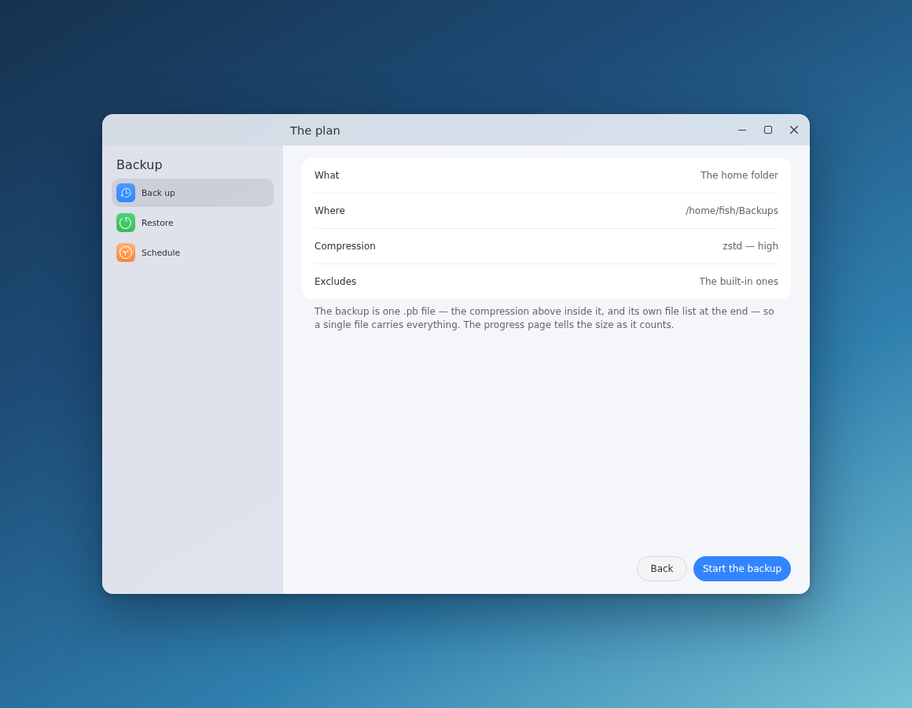
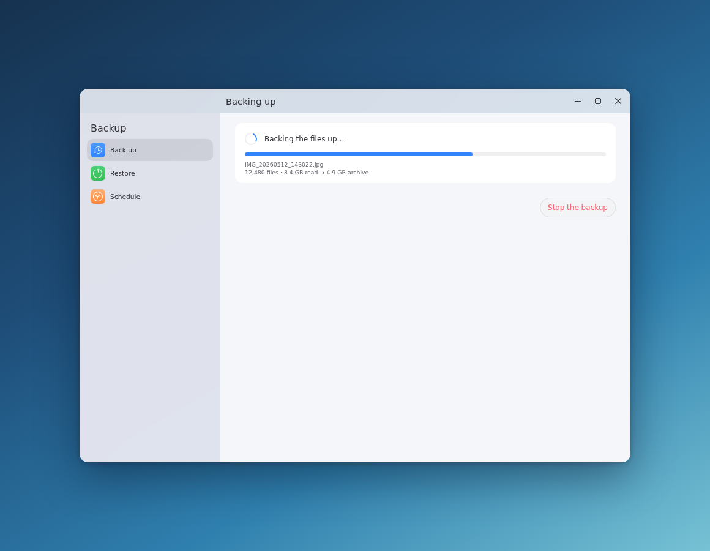
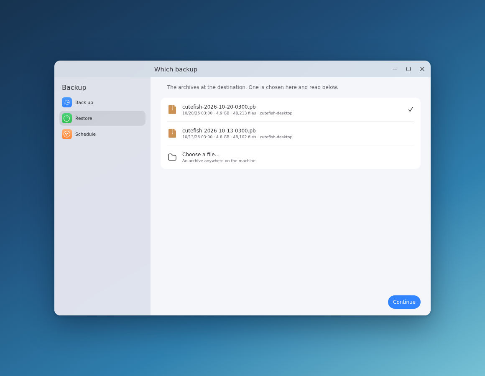
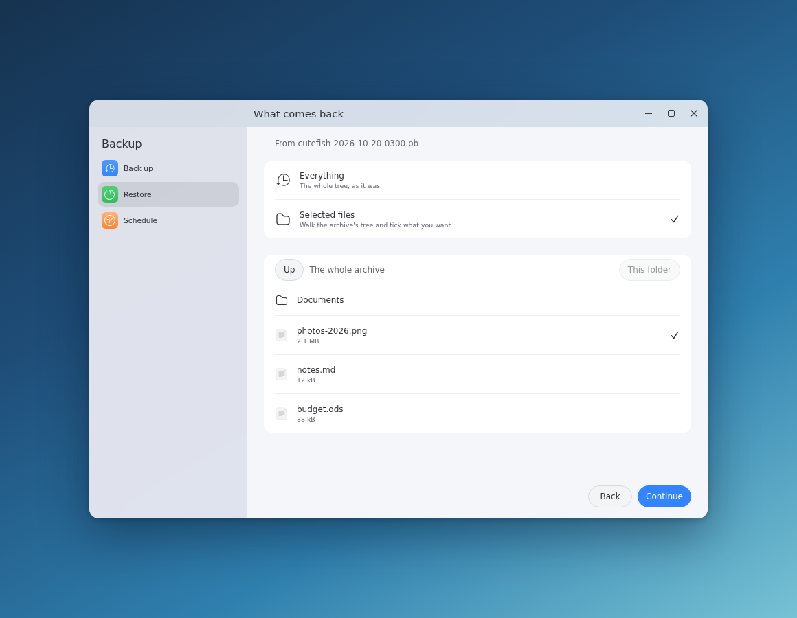
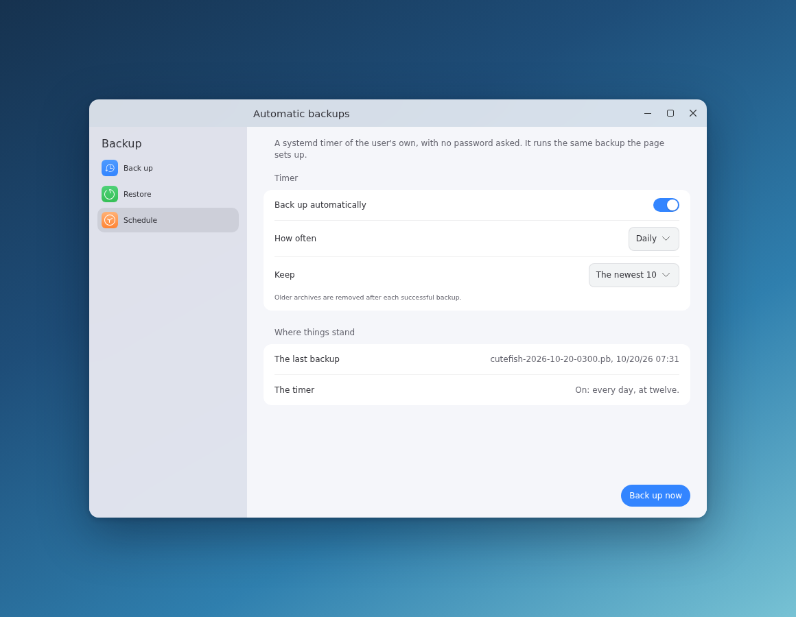
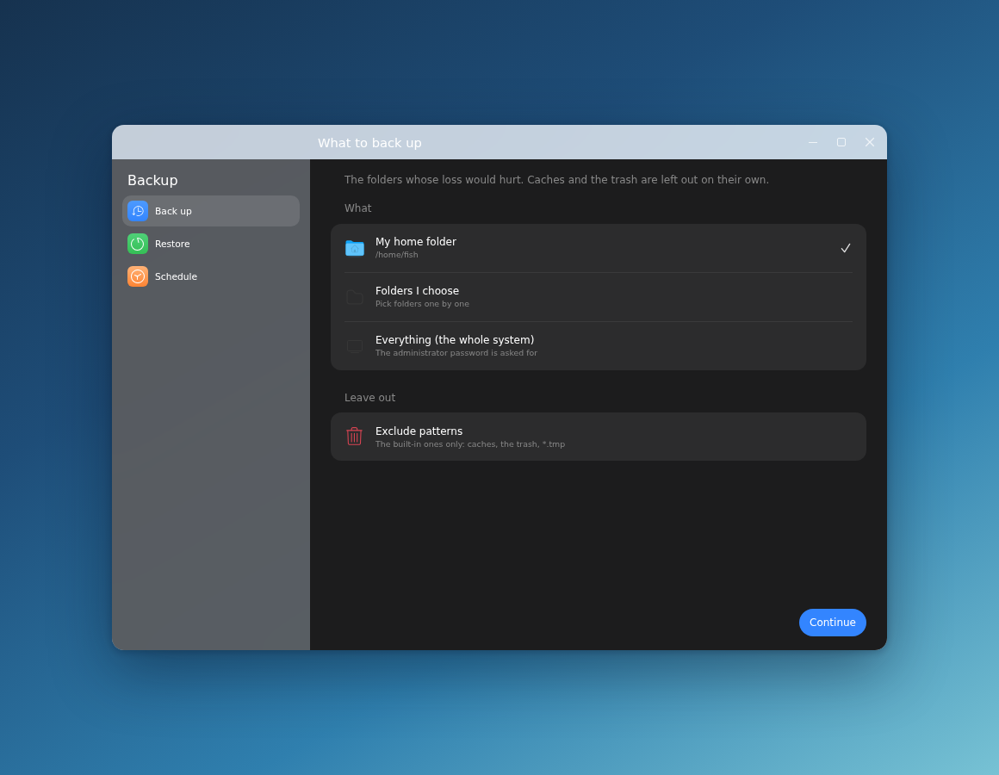

# Backup

The backup tool of the Cutefish desktop: whole folders kept in one heavily
compressed archive, put back file by file or all at once, on a timer or at a
click. The window is built on
[cutefish-toolkit](https://github.com/cutefishos/cutefish-toolkit) and uses
the [Cutefish icon theme](https://github.com/cutefishos/icons); the work
itself is one program, `cutefish-backupctl`, that the window runs and that
runs on its own just as well.

## What it does

- **One Portable Backup per run** — a `.pb` file of the tool's own shape:
  a header that names the codec, the codec-compressed tar under it, and the
  file's own list of contents at the end, so a single file carried anywhere
  carries everything of itself. The default codec is the LZMA2 that `xz`
  uses, for the smallest files; `zstd` when speed matters and `gzip` where
  every machine must read it — and whichever it is, the name stays `.pb`,
  because the file says its compression itself.
- **A window in the desktop's own shape** — the settings app's pattern:
  a sidebar of pages over frosted glass, the page's name in the header,
  cards of rows with the theme's own separators and switch, and the
  dialog's own pill buttons at the end of every line. Three pages —
  *Back up*, *Restore*, *Schedule* — walk what to keep (the home folder,
  folders of your own, or everything on the disk with the administrator's
  blessing), where to keep it (external disks are found on their own), and
  how hard to squeeze it.
- **A restore that browses**: beside every archive sits a small index the
  restore page reads, so the files inside are listed without opening the
  archive. Pick a folder, tick the files you want, put them back where they
  came from or into a folder of your choice.
- **Exclude patterns** the GNOME backup tools would understand: `*.o` by
  name, `Documents/` by folder, `/home/user/secret` by path. Caches, the
  trash and `*.tmp` are left out before your own rules are even read.
- **A systemd user timer** for the automatic backup, keeping the newest
  archives and pruning the rest. No password asked, as it backs up the home
  folder only.
- **Progress you can read**: the window shows the file being read and the
  archive growing behind it; the same events are plain JSON on the CLI's
  stdout, for anything else that cares.

## Screenshots

The window, as it is laid out by the toolkit's own tokens — the settings
app's sidebar, cards, rows and pill buttons, the Cutefish icon theme:

| | |
|---|---|
|  |  |
| *The What page: the source and the excludes* | *The destination and the compression* |
|  |  |
| *The plan, before it runs* | *The run, with the archive growing behind* |
|  |  |
| *The restore's archives* | *Browsing the index, ticking files* |
|  |  |
| *The timer and the last run* | *The dark theme follows the desktop* |

## The parts

| Program | What it is |
|---|---|
| `cutefish-backup` | The window, on the Cutefish desktop's own UI toolkit |
| `cutefish-backupctl` | The tool itself: backup, restore, list, browse, verify, prune, targets, schedule. Runs anywhere, Cutefish or not |
| `backup-core` | The engine shared by both: libarchive and POSIX, nothing else |

The window never does the archiving itself. It starts
`cutefish-backupctl` and reads the JSON events it prints; a whole-disk
backup goes the same way through `pkexec`, with the polkit action
`org.cutefish.backup.system` saying what the password is asked for. The
timer starts the CLI directly, with the same settings the window wrote to
`~/.config/cutefish/backup.conf` — so every path into the tool runs the
same code.

```
cutefish-backupctl backup  --from-config            # what the window and the timer run
cutefish-backupctl backup  --source ~/Videos --destination ~/Backups --compression zstd-fast
cutefish-backupctl list    --json                  # the archives, machine-readable
cutefish-backupctl browse  --archive ARCHIVE --path home/alice --json
cutefish-backupctl restore --archive ARCHIVE --path home/alice/Documents --to ~/restored
cutefish-backupctl verify  --archive ARCHIVE
cutefish-backupctl prune   --keep 10
cutefish-backupctl targets --json                  # the disks an archive may sit on
cutefish-backupctl schedule on --frequency weekly  # the systemd user timer
```

Exit codes: `0` well, `1` failed, `2` cancelled, `3` the command line was
wrong. With `--progress-events`, progress comes as one JSON object a line
on stdout; the words for a person still go to stderr, where the journal
keeps them.

## Dependencies

The core needs [libarchive](https://www.libarchive.org/) (13.0 or newer,
for zstd writing). The window is built on
[cutefish-toolkit](https://github.com/cutefishos/cutefish-toolkit), whose
own dependencies — Wayland, Skia, fontconfig — are the desktop's; see its
README. The whole-system backup and restore ask for polkit. The timer needs
systemd. For the tests: nothing more.

Debian/Ubuntu:

```shell
sudo apt install build-essential cmake pkg-config libarchive-dev gettext
```

## Build

Follow
[getting-started](https://github.com/cutefishos/getting-started) to install
cutefish-toolkit first; then:

```shell
cmake -S . -B build -DCMAKE_INSTALL_PREFIX=/usr
cmake --build build
sudo cmake --install build
```

Without cutefish-toolkit on the machine the window is skipped, the
command-line tool and the engine build and install just the same, and
`-DBUILD_GUI=OFF` skips the window on purpose.

### Tests

The engine's own tests are real end to end: a tree is made, backed up in
every compression, browsed, restored and compared byte for byte, with the
excludes held out and the hard links and symlinks put back as they were.

```shell
cmake -S . -B build -DBUILD_TESTING=ON
cmake --build build
ctest --test-dir build --output-on-failure
```

## Translations

`po/cutefish-backup.pot` holds every string of the window and the CLI. Add
a language by copying the template to `po/<code>.po` and filling it in:

```shell
msginit --no-translator --no-wrap -l de_DE.UTF-8 -i po/cutefish-backup.pot -o po/de.po
```

Keep each `{name}` placeholder as it is; the maintainers' own targets
refresh the template and merge it back:

```shell
cmake --build build --target update-translations
cmake --build build --target check-translations
```

## The .pb file

A backup is one file — `cutefish-backup-home-20261022-143005.pb` in the
destination — of the tool's own container shape, the **Portable Backup**:

| Offset | Size | What it is |
|---|---|---|
| 0 | 4 | the magic: `CPB` + `0x01`, container version 1 |
| 4 | 1 | the codec: `0` xz (LZMA2), `1` zstd, `2` gzip, `3` none |
| 5 | 1 | the compression level |
| 6 | 2 | flags, little-endian; bit 0: a trailer follows |
| 8 | 4 | the header's own length, 16 |
| 12 | 4 | reserved |
| 16 | … | the payload: the codec's stream of a POSIX PAX tar |
| end − 12 | 12 | the trailer's footer: `CPBT` + the trailer's length, u64 |

The trailer holds what the two files beside a backup hold — `version(4) +
reserved(4) + index length(8) + index + meta length(4) + meta`, all
little-endian — so a `.pb` copied anywhere on its own still lists its own
tree and knows which machine made it. Its bounds are read from the file's
own bytes and must add up exactly, never from the flags alone.

Beside the `.pb` file sit the two small files, no more than a cache of what
it carries inside:

- `….pb.index` — every entry on a line, the restore page's own quick way
  in. Deleting it costs nothing: the trailer answers just as fast.
- `….pb.meta` — the machine, the folders, the counts, for the overview.

The tar inside keeps whole paths below `/` — `home/alice/Documents/…` — so
a restore to the original places lands on the same ones whatever the
destination was, and a restore into a folder keeps the tree you know. Hard
links stay links; symlinks keep pointing where they pointed. Permissions
and times are kept.

Archives written before the `.pb` container — plain `.tar.xz`, `.tar.zst`,
`.tar.gz` and `.tar` — open as they always did: the reader tells the
container by the bytes themselves, never by the name.

For the desktop to know the file, `data/mime/cutefish-backup.xml` gives
the MIME type `application/x-cutefish-backup`, by the magic as by the
ending; `file` tells it from the magic alone:

```magic
# Cutefish Portable Backup
0  string  CPB\x01  Cutefish Portable Backup
```

## License

BSD 3-Clause; see [LICENSE](LICENSE). The bundled app icon is
`preferences-system-backup` from
[cutefishos/icons](https://github.com/cutefishos/icons), GPL-3.0 there;
the theme's own copy ships with the desktop.
